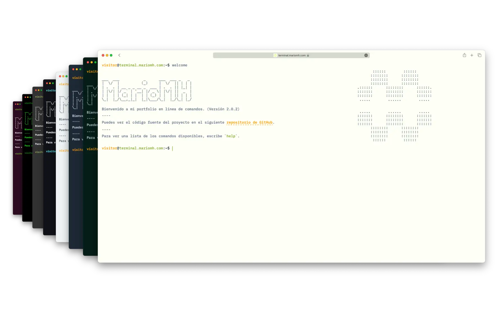

<h1 align="center">
  terminal.mariomh.com
</h1>

<p align="center">
  Portfolio personal en formato terminal que se ejecuta en el navegador.
</p>

<p align="center">
  <a href="https://terminal.mariomh.com"></a>
  <a href="LICENSE"></a>
</p>



## Índice

- [Características](#características)
- [Tecnologías](#tecnologías)
- [Puntuación Lighthouse](#puntuación-lighthouse)
- [Requisitos](#requisitos)
- [Ejecutar el proyecto](#ejecutar-el-proyecto)
- [Comandos](#comandos)
- [Desplegar el sitio](#desplegar-el-sitio)
- [Estructura del proyecto](#estructura-del-proyecto)
- [Contribuir](#contribuir)
- [Seguridad](#seguridad)
- [Licencia](#licencia)
- [Inspiración y créditos](#inspiración-y-créditos)

## Características

- 📱 Diseño responsive.
- 🎨 Soporte para múltiples temas.
- ✨ Autocompletado de comandos con `Tab` o `Ctrl + I`.
- ⬆️ Ir al comando anterior y siguiente.
- 📖 Ver el historial de comandos.
- 🔥 PWA y soporte offline.
- 🇬🇧 Soporte para inglés y 🇪🇸 español.

## Tecnologías

- **Runtime y gestor de paquetes** - [Bun](https://bun.sh) 1.4.4
- **Frontend** - [Astro](https://astro.build) y [Preact](https://preactjs.com)
- **Estilos** - CSS puro
- **Gestión de estado** - [nanostores](https://github.com/nanostores/nanostores)
- **Lenguaje** - [TypeScript](https://www.typescriptlang.org)
- **Despliegue** - [Cloudflare Pages](https://pages.cloudflare.com)

## Puntuación Lighthouse



## Requisitos

- Bun 1.4.4
- Git
- Un token de acceso personal de GitHub con `read:packages` para instalar `@mariomh8/resume`

## Ejecutar el proyecto

Clona el repositorio e instala las dependencias:

```bash
git clone https://github.com/MarioMH8/terminal.mariomh.com.git
cd terminal.mariomh.com
bun install
```

Arranca el servidor de desarrollo:

```bash
bun run dev
```

El sitio consume el paquete privado `@mariomh8/resume`. Añade el scope y tu token a la configuración de npm de usuario:

```ini
//npm.pkg.github.com/:_authToken=${NPM_TOKEN}
@mariomh8:registry=https://npm.pkg.github.com/
```

Exporta `NPM_TOKEN` con un token de acceso personal clásico de GitHub que tenga el permiso `read:packages`. En CI, el workflow de comprobación usa `GITHUB_TOKEN` con `packages: read`.

## Comandos

| Tarea | Comando |
| --- | --- |
| Arrancar el servidor de desarrollo | `bun run dev` |
| Construir el sitio | `bun run build` |
| Previsualizar la build | `bun run start` |
| Comprobar tipos | `bun run typecheck` |
| Comprobar tipos de Astro | `bun run typecheck:astro` |
| Lint sin escribir cambios | `bun run lint:ci` |
| Lint y corrección automática | `bun run lint:fix` |

## Desplegar el sitio

El sitio se despliega automáticamente cuando el workflow `Continuous integration` termina correctamente en `main`. También puedes ejecutar el workflow [Deploy](https://github.com/MarioMH8/terminal.mariomh.com/actions/workflows/deploy.yml) manualmente con `workflow_dispatch`.

## Estructura del proyecto

```text
src/               Sitio Astro y Preact: componentes, comandos, layouts, páginas y estilos
public/            Archivos estáticos, iconos y el manifiesto de la aplicación web
docs/              Capturas, el resultado de Lighthouse y las guías para agentes
.github/           Workflows, plantillas de issue y CODEOWNERS
```

## Contribuir

Lee [CONTRIBUTING.md](CONTRIBUTING.md) antes de abrir una issue o un pull request. El proyecto sigue un flujo issue-first, Conventional Commits y GitFlow con `develop` como rama de integración y `main` para las versiones estables.

- [AGENTS.md](AGENTS.md): punto de entrada a las guías del repositorio.
- [docs/agents/](docs/agents/): arquitectura, convenciones, desarrollo, releases, pull requests y ramas.

## Seguridad

No publiques vulnerabilidades en una issue pública. Sigue [SECURITY.md](SECURITY.md) y usa el reporte privado de vulnerabilidades de GitHub.

## Licencia

El código fuente está licenciado bajo la [licencia MIT](LICENSE).

Los mensajes de la terminal, las traducciones, las imágenes y el texto de la documentación están **todos los derechos reservados**. Consulta [CONTENT-LICENSE.md](CONTENT-LICENSE.md) para ver el alcance exacto.

## Inspiración y créditos

Algunas características e interacciones están inspiradas en estos sitios de terminal. Todo el código está escrito desde cero.

- [Terminal Portfolio by Sat Naing](https://terminal.satnaing.dev/)
- [term m4tt72](https://term.m4tt72.com/)
- [Forrest](https://fkcodes.com/)
