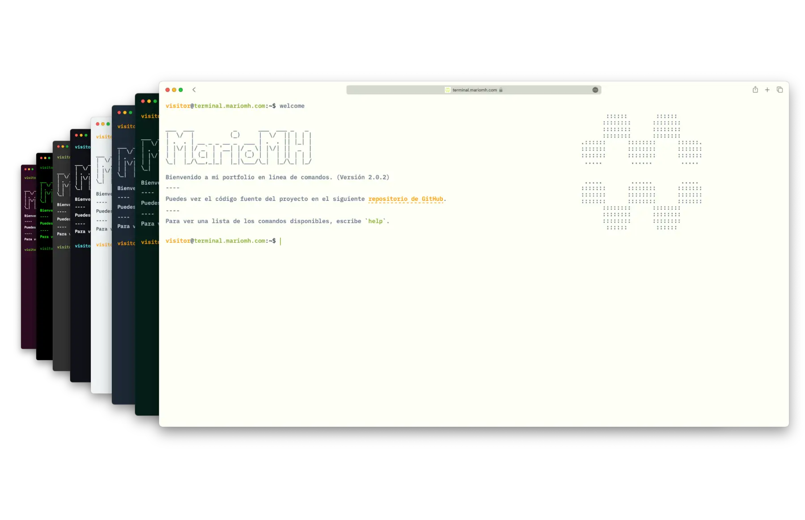

<h1 align="center">
  terminal.mariomh.com
</h1>

<p align="center">
    Terminal style portfolio website
</p>



## Features

- 📱 Responsive Design
- 🎨 Multiple themes
- ✨ Autocomplete feature (TAB | Ctrl + i)
- ⬆️ Go previous and next command
- 📖 View command history
- 🔥 PWA and Offline Support
- 🇬🇧 English and 🇪🇸 Spanish support

## Tech Stack

- **Runtime** - [Bun](https://bun.sh)
- **Frontend** - [Astro](https://astro.build/), [Preact](https://preactjs.com/)
- **Styling** - Plain CSS
- **Deployment** - [Cloudflare Pages](https://pages.cloudflare.com/)
- **Languages** - [TypeScript](https://www.typescriptlang.org/)
- **State Management** - [nanostores](https://github.com/nanostores/nanostores)

## Lighthouse Score



## Running Locally

Clone the project

```bash
git clone https://github.com/MarioMH8/terminal.mariomh.com.git
```

Go to the project directory

```bash
cd terminal.mariomh.com
```

Install dependencies

```bash
bun install
```

Start the development server

```bash
bun run dev
```

The site consumes `@mariomh8/resume` from GitHub Packages. Local installs need a classic GitHub personal access token with `read:packages` in your user-level npm configuration. CI uses the `PACKAGES_TOKEN` Actions secret. See [CONTRIBUTING.md](CONTRIBUTING.md) for the complete setup.

## Deploying the project

The site deploys automatically after the `Continuous integration` workflow succeeds on `main`. You can also run the [Deploy](https://github.com/MarioMH8/terminal.mariomh.com/actions/workflows/deploy.yml) workflow manually with `workflow_dispatch`.

## Project Structure

The project is organized into several main directories and files:

- `src/`: This directory contains all the source code for the project.
  - `components/`: Contains the project-specific components.
  - `layouts/`: Contains the base layout of the page.
  - `pages/`: Contains the Astro components that represent the pages of the application.
  - `styles/`: Contains the global styles of the application.
- `public/`: This directory contains all the static files.

## Inspiration and Credits

Here are some inspiration for this kind of terminal website. Only some features and functionalities are inspired by these following websites. All codes are written on my own.

- [Terminal Portfolio by Sat Naing](https://terminal.satnaing.dev/)
- [term m4tt72](https://term.m4tt72.com/)
- [Forrest](https://fkcodes.com/)
